# Smart Pantry Manager

A Java Android app that helps reduce food waste. The user records the ingredients they already
have at home (their "pantry"), and the app suggests recipes they can cook **strictly** from those
ingredients - a recipe is only suggested if every ingredient it needs is in the pantry in at
least the required quantity.

Module: Mobile App Development 700 - Practical Assignment (Richfield).

## Features
- Pantry management: add, edit and delete ingredients (name, quantity, unit, optional expiry date)
- Pantry list screen (RecyclerView with a custom adapter, bound to the database)
- 22 pre-loaded recipes (seeded on first run)
- Suggested Recipes screen using the strict-matching rule
- Recipe detail screen (ingredients + method)
- Settings screen (expiry highlighting toggle, optional "Almost There" list, clear pantry)
- Friendly message when no recipes match
- Input validation on the add/edit form
- Bottom navigation bar

## Strict-matching rule
`RecipeMatcher.java` implements the rule. Names are normalised (case, simple plurals such as
"tomatoes" = "tomato"), units are converted (kg->g, l->ml, cup/tbsp/tsp->ml), and duplicate pantry
rows of the same ingredient are added together before comparing against the recipe.
Counted items (pcs) and weighed or measured items (g, ml) are different unit families and are not
converted into each other.

## Database choice: SQLite
SQLite (via `SQLiteOpenHelper`) runs locally on the device, needs no network, account or backend,
and persists data across app restarts. It fits this app because the data is small and relational
(pantry items, recipes, recipe ingredients) and only one user needs it.

Tables: `pantry`, `recipes`, `recipe_ingredients`.

## Project structure
```
app/src/main/java/com/example/smartpantry/
  MainActivity.java              Pantry list screen
  AddEditItemActivity.java       Add / edit form with validation
  SuggestedRecipesActivity.java  Strict suggestions (+ optional Almost There list)
  RecipeDetailActivity.java      Ingredients and method
  SettingsActivity.java          Toggles and clear pantry
  DatabaseHelper.java            SQLite tables, CRUD and recipe seed data
  RecipeMatcher.java             The strict-matching algorithm
  PantryAdapter.java / RecipeAdapter.java   RecyclerView adapters
  PantryItem / Recipe / RecipeIngredient    Model classes
app/src/test/java/com/example/smartpantry/
  RecipeMatcherTest.java         Unit tests for the matching rule
```

## Setup / run instructions
1. Install Android Studio (latest stable).
2. Clone this repository: `git clone https://github.com/brian-mx/SmartPantry.git`
3. In Android Studio choose **File > Open** and select the project folder.
4. Let Gradle sync finish (needs an internet connection the first time).
5. Create or start an emulator (API 24 or higher), or connect a physical device with USB debugging on.
6. Press **Run**.

No API keys, location permissions or internet access are required at runtime.

To run the unit tests, right-click `RecipeMatcherTest` in the Project panel and choose **Run**.

## Screenshots

| Empty pantry | Validation: name | Validation: quantity |
|---|---|---|
| 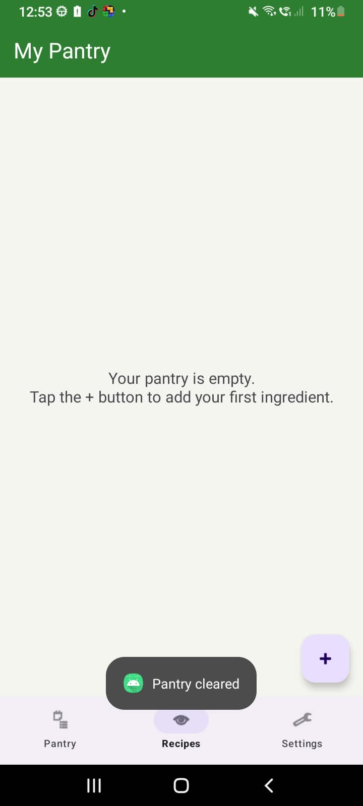 | 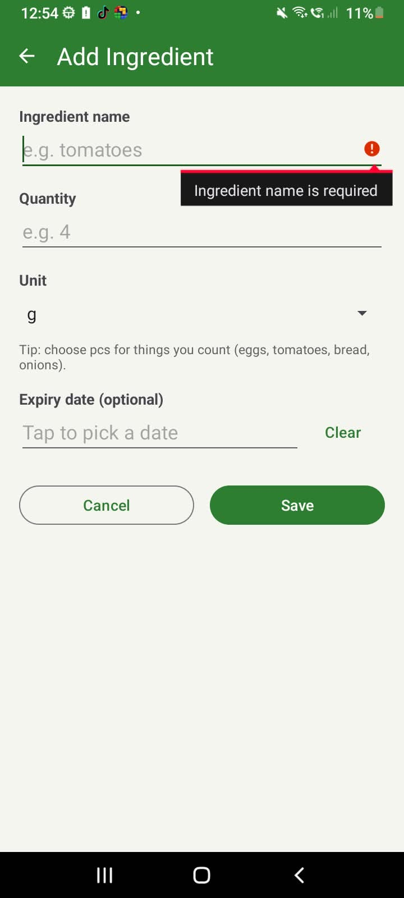 | 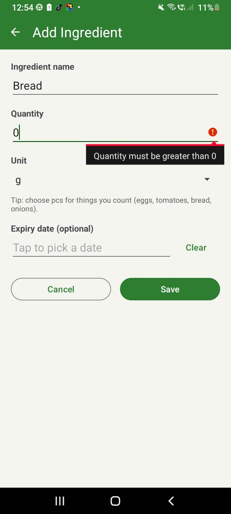 |

| Pantry list | Edit ingredient | Delete confirmation |
|---|---|---|
| 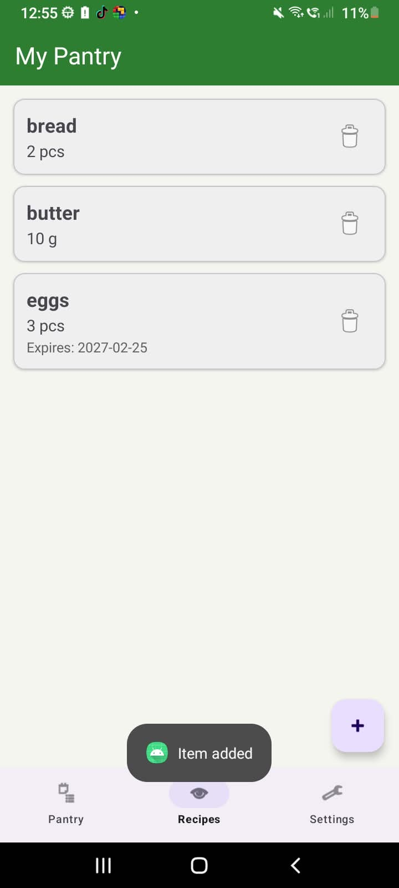 | 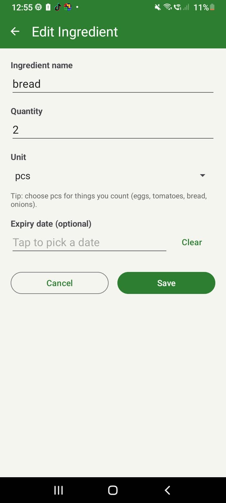 | 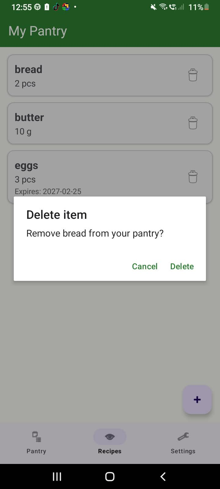 |

| Suggested recipes + Almost There | No strict match + Almost There | No recipes match |
|---|---|---|
| 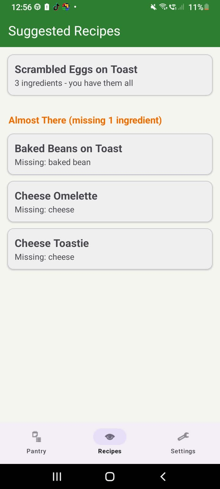 | 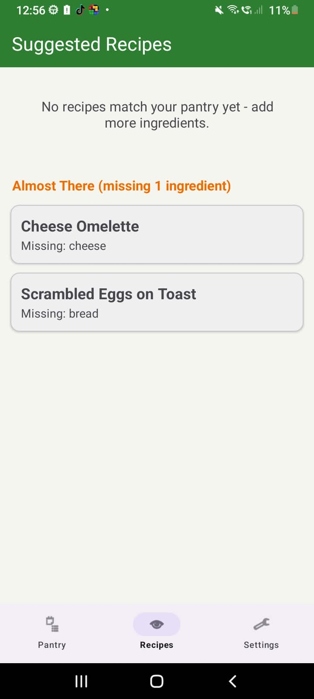 | 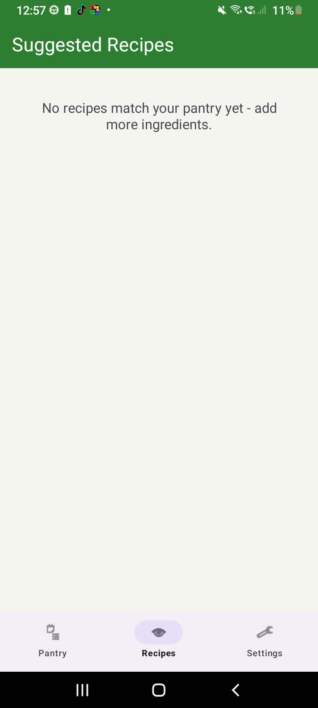 |

| Recipe detail | Settings |
|---|---|
| 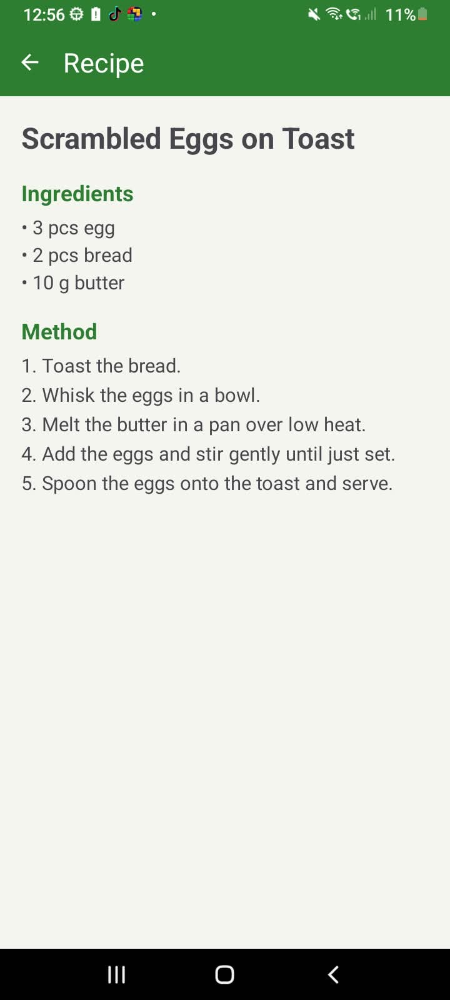 | 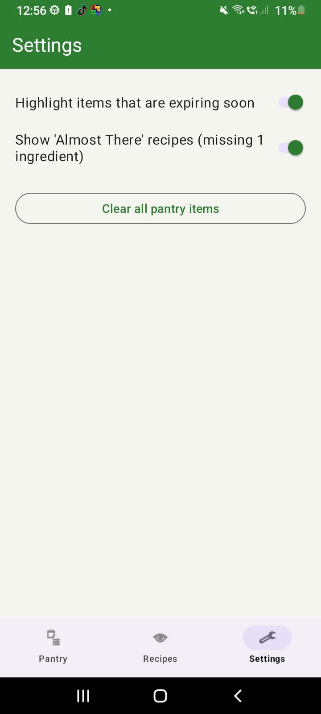 |
